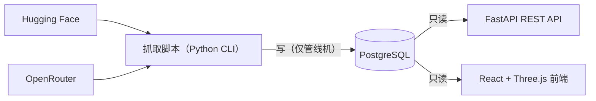

# AGENTS.md

本文件是本仓库的**项目记忆**，供所有在此工作的 AI agent 与人阅读。
设计原则：只放「代码里推不出来」的内容——铁律、踩坑、指针；
参考细节（schema、API、环境变量详解、命令全集、前端架构）在 [ARCHITECTURE.md](ARCHITECTURE.md)。

**维护要求**：踩到新坑或改约定时更新本文件；新增内容前先自问"这条能否从代码/测试推导出来"，
能推导的写进 ARCHITECTURE.md 或干脆不写。本文件是公开仓库的一部分，不要写入私密信息。

---

## 1. 项目是什么

交互式 3D 大模型发布时间轴：抓取 Hugging Face / OpenRouter 元数据 → PostgreSQL →
LLM 生成模型分析 → Three.js 螺旋时间轴渲染。



**关键设计边界**：抓取只在数据管线机器上跑，Web 服务侧纯只读查询。
不要让 API 去抓数据。

**目录与入口**（别猜位置，先看这里）

```text
backend/     FastAPI 只读 API（backend/main.py 路由全在这一个文件）
frontend/    React + Three.js；App.tsx → pages/HomeWithAnalysis.tsx → components/Timeline3D.tsx（渲染大头）
src/scraper/ 抓取与分析 CLI：fetch_models.py（HF）、fetch_models_openrouter.py（OR）、analysis_orchestrator.py（LLM 分析）
scripts/     daily_sync.sh（每日编排）、dev_db.sh（本地库）、init_db.py（建表）
tests/       pytest；test_api_contract.py 是路由不变量测试
docs/        内部文档（gitignore）：issues/ 是缺陷档，不进仓库
```

---

## 2. 铁律（每条都有事故前科）

**环境与执行**

1. Python 命令一律用 `.venv/bin/python` 完整路径；venv 用 `uv venv .venv --python 3.12` 建
   （`python3 -m venv` 在 uv/pyenv 托管的机器上会建出没有 pip 的环境）。
2. 依赖装两份：`requirements.txt`（抓取+分析）+ `backend/requirements.txt`（API）。
3. 启动 dev server / 长驻进程前先问人。破坏性操作（删文件、force push、线上库写入）先确认——
   本项目抓取脚本直连线上库，**跑一次抓取就是生产写入**。
4. 沟通用中文；没验证过的不说成功，推测必须显式标注"未验证/推测"。

**数据与代码**

5. 时间列一律 **`timestamptz`**（UTC 存储，ISSUE-006 已全量迁移）：
   - 写入传 **aware `datetime`**（`datetime.now(timezone.utc)`、epoch/ISO 解析出的 UTC 值），
     **不要传格式化字符串**；naive datetime 会被按会话时区解释，本地 UTC+8 机器上整体偏 8 小时；
   - 读出是 aware datetime，但偏移量来自**会话时区**，所以 API 输出统一由
     `backend/models.py` 的 `UtcDatetime`（`AfterValidator`）归一成 UTC，响应永远带 `+00:00`；
     不要靠 `SET TIME ZONE 'UTC'` 兜底——Supabase transaction pooler 会话级设置不保证延续；
   - **不要再写 `::timestamptz`**：列已经是 timestamptz，多余转型只会掩盖真正的类型错误。
   SQL 按时间过滤报错时**别把报错误读成"没数据"**——这是这几列当年是 text/naive timestamp 留下的历史教训。
6. 统计真正新增用 `RETURNING (xmax = 0)`，**不是** `rowcount`
   （`ON CONFLICT DO UPDATE` 下 rowcount 恒为 1，会把更新误计成新增）。
7. 每日同步与 AI 分析是**两个独立定时任务**，不要合并；
   `daily_sync.sh` 内部强制 `ENABLE_POST_SCRAPE_ANALYSIS=false`（原因见踩坑 4.1/4.3）。
8. `ENABLE_LEADERBOARD_LOOKUP` 保持 **false**；日志里的"排行榜在线查询未启用"不是故障。
9. `DEEPSEEK_API_URL` 填 base_url（`https://api.deepseek.com/v1`），
   填完整端点 = SDK 重复拼接 = **每个模型都 404**。
10. 前端环境变量作用域是 `frontend/`（Vite envDir），根目录 `.env` 对前端无效；
    `VITE_API_TARGET` / `VITE_HMR_*` 只能从 shell 传；构建期内联的 `VITE_API_BASE`
    填成 `http://localhost:8000` 会让线上页面请求访问者自己的 8000 端口（页面能开、数据全空）。
11. `model_id` 含斜杠 → 路由必须 `{model_id:path}`；兜底路由必须放所有固定路径之后
    （`tests/test_api_contract.py` 的不变量测试守着，改路由先跑它）。
12. `PROVIDERS_OPENROUTER` 是白名单过滤器。匹配用的 key 由 `provider_key_for()` 解析：
    **品牌别名优先**（`mistralai`→`mistral`、`meta-llama`→`meta`、`z-ai`→`z.ai`、
    `x-ai`/`xai`→`spacexai`，见 `PROVIDER_KEY_ALIASES`）→ 否则用 name 里的展示名
    （`Display: Model` 冒号前那段）→ 再用 id 前缀兜底（`qwen`、`gryphe`、`rekaai` 这类前缀
    本身就是条目）。新增别名要写进 `PROVIDER_KEY_ALIASES`，别在环境变量里凑。
    `OPENROUTER_DAILY_FETCH_LIMIT` 是**白名单过滤之后**的上限（ISSUE-030 已改为先过滤后截断，
    截断会打 WARNING），推荐 `0` = 不截断。
    填错的表现：该厂商一条进不来——现在会打「白名单里有 N 个条目一条都没匹配到」的 WARNING。

13. `PROVIDERS` 是 HF 的 `?author=` **作者名，大小写敏感**：`nousresearch` 返 0 条、
    `NousResearch` 才有；`liquidai` 同理要写 `LiquidAI`。填错不报错，只是静默少一家。
    新增 org 前先 `curl "https://huggingface.co/api/models?author=<名字>&limit=1"` 确认能返回数据；
    另外抓取默认带 `HF_PIPELINE_TAG=text-generation`，留空会把视觉/语音仓库一起抓进时间轴。

**文档**

14. `docs/` 整体被 gitignore（内部文档），**不要加回 git**。
15. Markdown 图例用 mermaid，禁止 ASCII 字符画（规范见技能 `mermaid-md-diagrams`）；
    用户点名 documd / docu.md 时改走 `documd-visuals`，两者不混用。

**流程**

16. 修缺陷先有档：`docs/issues/` 里没有就先立一条（现象/证据/修法/验证方式），
    修完写回状态与提交号；动手时发现范围变了，回档改范围再继续。
    反例：23 个问题曾散在两份临时文档里，回头得逐条复测才敢动手——**没档的"顺手修"既没人记得修了什么，也没人知道还剩什么**。

---

## 3. 命令速查

```bash
# 环境（本地开发）
uv venv .venv --python 3.12 && .venv/bin/pip install -r requirements.txt -r backend/requirements.txt
bash scripts/dev_db.sh start        # 本地 PG（含测试库），数据在 /tmp，无需 Docker

# 服务
.venv/bin/python scripts/init_db.py                          # 建表（幂等）
.venv/bin/python -m uvicorn backend.main:app --reload --port 8000
cd frontend && npm run dev | npm run build                   # build 含 tsc 检查

# 测试（需 TEST_DATABASE_URL；dev_db.sh start 会一并建好）
.venv/bin/python -m pytest tests/ -q

# 数据管线（⚠️ 直连线上库，随手跑就是生产写入）
bash scripts/daily_sync.sh [--dry-run]                       # 每日同步编排
.venv/bin/python -m src.scraper.analysis_orchestrator        # AI 分析（独立任务）
.venv/bin/python scripts/check_supabase.py                   # 体检（只读，可安全贴输出）
```

测试基线：`475 passed`，约 22 秒（需 `TEST_DATABASE_URL`，`scripts/dev_db.sh start` 会建好测试库）。
async 用例已在 2026-10-18 装上 `pytest-asyncio` 后真正执行——此前 33 个 async 用例一直是被跳过的，
"全绿"并不覆盖它们。**测试不许依赖真实网络**：mock 漏一个客户端就会变成 70 秒超时 + 回落假数据，
既慢又不稳定。详解见 ARCHITECTURE.md 第 8 节。
抓取/分析命令全集见 ARCHITECTURE.md 第 5 节。

**验证按需**：改前端就跑 `npm run build`（含 tsc）；改后端就跑对应的 `pytest tests/<file>`。
不要为了"确认没坏"擅自起 dev server、跑全量抓取或全量测试——前者挂住会话，后两者是生产写入/耗时。
不确定该跑什么就问。

---

## 4. 踩坑记录（现象 ≠ 根因，排障先扫这节）

### 4.1 静默失败：被 try/except 吞掉的 bug（本仓库最危险模式）

- 现象：`model_analysis` 长期为空，但所有脚本退出码都是 0。
- 根因：同步入口直接把 `async def` 的返回值（coroutine 对象）当下标用，抛
  `TypeError: 'coroutine' object is not subscriptable`，被 try/except 吞成一行 warning。
- 铁律：顺手做的额外事不要静默吞异常，至少非 0 退出或明确告警；**修静默失败必须配回归测试**。

### 4.2 代理变量打死 httpx（报错极具误导性）

- 现象：抓取正常、AI 分析 100% 失败。报错却让你装 `socksio`，或 `Invalid port: ':1]'`。
- 根因：shell 有 `all_proxy=socks5://` 或 `no_proxy` 含 `[::1]` 时，httpx 系
  （openai SDK、头像回退）直接挂；requests / aiohttp 不受影响。
- 铁律：本机直接跑分析入口前 `unset all_proxy ALL_PROXY` 并修掉 `no_proxy` 里的 `[::1]`；
  `daily_sync.sh` 已自带清理。

### 4.3 在线排行榜查询 = 68 秒/模型 + 假数据兜底

- 三个上游客户端串联约 68s，超过 `ANALYSIS_TIMEOUT_SECONDS=30` 的预算，
  LLM 还没调用就被 `asyncio.wait_for` 掐断，分析全军覆没；
  上游失败还会回落到写死的假排名（`_get_mock_leaderboard()`），等于拿编造事实喂 LLM。
- 这就是铁律 8 要求开关保持 false 的原因。

### 4.4 "看起来坏了" vs "从未接上"

`model_arena_info` 没有任何自动数据源（落库是空壳 TODO、零调用方），消费端静默显示为空。
它不报错、只是什么都不做——排查这类现象先问"这功能接上过吗"。

### 4.5 HF 把 description 从卡片元数据移除了

模型简介一度全空：根因是 HF 改接口，描述需从 README 抽取
（`fetch_models.py` 的 `extract_description_from_readme()`；增量抓取只补缺简介的模型）。

### 4.6 稳态下 `sync_log.inserted = 0` 不是故障

`processed` 正常而 `inserted = 0` = 本轮没有新模型，抓取链路是健康的。

### 4.7 HF 的 `filter=` 是标签过滤，`pipeline_tag=` 才是任务过滤

- 现象：按 `filter="text-generation"` 抓 HF，embedding / 图像仓库照样进来
  （`Qwen3-Embedding-8B` 的 `pipeline_tag` 是 `feature-extraction`，却也带着
  `text-generation` 标签——作者打的标签，跟任务分类不是一回事）。
- 铁律：筛任务用 `list_models(pipeline_tag=...)`；`filter=` 只用来筛 tag。
  改完要抽查新增行：`pipeline_tag` 不是目标任务的应当删掉并记档。
- 同一类陷阱：`ON CONFLICT DO UPDATE` 里别覆盖 `created_at`/`inserted_at` 这类时间列
  （ISSUE-035：一次日常抓取把「首次入库时间」全改成了当天，1411 个新增被数成 1976）。

### 4.8 事务里的「打印」能把整批写入悄悄回滚

- 现象：回填脚本打印「已写入: 71 行」，退出码 0，但库里 `merged_into` 非空行数是 **0**。
- 根因：连接用了 `row_factory=dict_row`，写入后的复核语句写成 `cur.fetchone()[0]`
  → `KeyError: 0` → 异常抛出 → `with psycopg.connect(...)` 退出时**整体回滚**，
  而屏幕上「已写入」早几行就打印完了。
- 铁律：**写完先 `commit()` 再打印/复核**；复核用新连接；「计划非空但复核为 0」要非 0 退出。
  同类坑：日志/统计代码不要留在事务里，它们抛异常等于悄悄撤销所有写入。

---

## 5. 未修问题的位置（不要在这里维护清单）

未修问题档案在 `docs/issues/INDEX.md`（本地，不进仓库），按编号 + 严重级 + 状态追踪。

本节**刻意不列缺口清单**：清单要随状态反复改，写在这儿必然过期，还会让本文件频繁变动。
排查前用索引，别指望在这里看到"最新病情"。

**纪律**：问题修完后，把**机制级**教训提炼成第 4 节的一条踩坑
（代码里推不出来、下次还会踩的那种，例如 4.4「看起来坏了 vs 从未接上」），
明细留在 issue 档里。

维护改进计划见 `docs/项目维护改进项.md`（本地）。

---

## 6. 深入阅读

| 想了解 | 去哪 |
|---|---|
| 数据库 schema / API / env 详解 / 命令全集 / 前端架构 | [ARCHITECTURE.md](ARCHITECTURE.md) |
| 环境变量全表与默认值 | [.env.example](.env.example) |
| 未修问题的排查档案 | `docs/issues/INDEX.md`（本地，不进仓库） |
| 项目总览与快速上手 | [README.md](README.md) |
