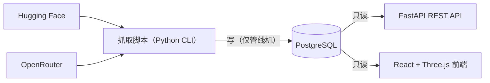

# Architecture & Reference — Silicon River

> 配套 [AGENTS.md](AGENTS.md)（那里只放铁律与踩坑）。本文收录「代码里能找到、但集中成一篇更好读」的参考细节。
> **以代码为准**：schema 看 `scripts/init_db.py`，API 看 `backend/main.py`，环境变量看 [.env.example](.env.example)。
> 发现本文与实现不符：以实现为准，并回来更新本文。
>
> 最后更新：2026-10-15

---

## 1. 系统架构

Silicon River 从 Hugging Face 与 OpenRouter 抓取模型元数据，存入 PostgreSQL，
用 LLM 生成模型分析，并通过 Three.js 螺旋时间轴渲染。



**关键设计边界**：抓取只在数据管线机器上跑，**Web 服务侧是纯只读查询**，永不抓取。

### 技术栈

| 层 | 技术 |
|---|---|
| 后端 | FastAPI（Pydantic 校验）、Psycopg 3 |
| 前端 | React 18 + TypeScript、Vite、Three.js |
| 样式 | Tailwind CSS + Headless UI |
| 状态 | React Query（服务端）+ Hooks（本地） |
| 数据管线 | Python CLI（Click / argparse）、huggingface_hub |
| AI 分析 | DeepSeek（OpenAI 兼容接口） |

---

## 2. 数据库（六张表，DDL 在 `scripts/init_db.py`）

> ⚠️ 早期文档对 `sync_log` / `models` 的字段描述是错的，以本节为准（已核对线上库）。

### 2.1 类型陷阱：时间列存成了 TEXT

| 表.列 | 实际类型 | 说明 |
|---|---|---|
| `sync_log.started_at` / `finished_at` | **text** | 存 ISO 字符串 |
| `models.inserted_at` | **text** | 存 ISO 字符串 |
| `model_tags.inserted_at` | **text** | 存 ISO 字符串 |

任何按时间过滤的查询**必须显式转型**，否则直接报错：

```sql
-- ❌ operator does not exist: text >= timestamp with time zone
WHERE started_at >= NOW() - INTERVAL '1 day'
-- ✅
WHERE started_at::timestamptz >= NOW() - INTERVAL '1 day'
```

**不要把"SQL 报错"误读成"没有数据"**，那会导致误告警。

### 2.2 `models`（核心表）

`id`(bigint) / `model_id`(text, 主键) / `provider`(text) / `model_name`(text) /
`description`(text) / `tags`(text, JSON 字符串) / `created_at`(timestamp, 无时区) /
`downloads`(bigint) / `likes`(bigint) / `model_card_url`(text) /
`inserted_at`(**text**) / `is_open_source`(boolean) / `price`(jsonb) / `huggingface_rank`(int)

- `model_id` 形如 `provider/name`，**含斜杠**（影响 API 路由设计，见第 3 节）。
- `created_at` 对 HF 是 HF 记录的发布时间；对 OpenRouter 是 API 的 `created` 时间戳。

### 2.3 `model_analysis`

`id` / `model_id` / `provider` / `model_name` / `analysis_summary`(text) /
`key_features`(ARRAY) / `use_cases`(ARRAY) / `performance_metrics`(jsonb) /
`llm_model_used`(text) / `is_milestone`(boolean) / `milestone_features`(text) /
`analyzed_at` / `updated_at`

写入用 `ON CONFLICT (model_id) DO UPDATE`。

### 2.4 `sync_log`（**只被 HF 链路写入**）

`id` / `provider` / `started_at`(**text**) / `finished_at`(**text**) / `status`(text) /
`processed`(bigint) / `inserted`(bigint) / `error_message`(text)

- **每厂商每轮一行**，`status` 实测只出现过 `'success'`。
- `processed` = 本次看到的模型数；`inserted` = 本次**真正新增**的行数。判定 SQL：

  ```sql
  INSERT INTO ... ON CONFLICT ... DO UPDATE SET ...
  RETURNING (xmax = 0) AS is_insert   -- xmax = 0 表示这行是本次 INSERT 产生的
  ```

  **不能用 `rowcount`**：`ON CONFLICT DO UPDATE` 下恒为 1，会把"更新"误计成"新增"。
- 稳态下 `inserted` 经常为 0 而 `processed` 正常，这不是故障。
- ⚠️ **`fetch_models_openrouter*.py` 完全不写这张表**，也没有其他审计表——
  只按 `sync_log` 配监控，OpenRouter 那条线挂了是看不见的。

### 2.5 `model_arena_info`（排行榜评分）

`id` / `model_id` / `source` / `rank` / `score` / `category` / `updated_at` / `created_at`，
唯一键 `(model_id, source, category)`。

⚠️ **目前没有任何自动化数据来源**（落库环节是空壳 TODO），
写入端只有需要人工喂 JSON 的 CLI `scripts/update_arena_scores.py`。
前端 `ArenaScoreDisplay` 查不到会静默显示为空，不报错。

### 2.6 `providers`

`provider_id`(主键) / `display_name` / `avatar_url` / `avatar_blob`(bytea) /
`avatar_mime` / `updated_at` / `created_at`。

头像策略：首次抓取后把二进制缓存进库，后续请求带 `Cache-Control` 直接吐缓存；
blob 为空则回退上游 URL；有字节上限（`AVATAR_MAX_BYTES`，默认 524KB），超标也回退上游。

---

## 3. API（`backend/main.py`）

| 端点 | 说明 |
|---|---|
| `GET /api/timeline` | 时间轴数据。`preset`(30d/6m/1y/all)、`year`、`provider`、`model_name`、`open_source`、`page`、`page_size`(**10–500**，默认 200)、`sort`(asc/desc) |
| `GET /api/models` | 分页模型目录（无时间轴排序）。`page`、`page_size`、`provider`、`tag`、`search` |
| `GET /api/stats/providers` | 按提供商分组计数 |
| `GET /api/providers/{provider_id}/avatar` | 缓存的提供商头像，回退上游 |
| `GET /api/arena/scores/{model_id:path}` | 单模型排行榜评分 |
| `GET /health` | 最小化健康检查 |

### 路由相关的硬约束（有测试守着）

1. `model_id` 含斜杠 → 路由必须用 `{model_id:path}`，普通 `{model_id}` 匹配不到任何真实 ID。
2. 兜底路由必须放在所有固定路径**之后**（历史上 `/api/models/{model_id:path}` 放前面吃掉了全部固定路由）。
   [`tests/test_api_contract.py`](tests/test_api_contract.py) 里有路由顺序不变量测试。
3. 涉及长参数的查询用 **POST + 请求体**，别把 `model_id` 塞进 query string。

### 后端请求管道

1. FastAPI 路由做 Pydantic 校验
2. `_calculate_timeline_window()` 依 `preset` / `year` 算时间窗
3. Psycopg 3 **参数化查询**（防注入），JOIN `providers` 取头像
4. Pydantic 模型序列化为类型化 JSON

> **性能约束**：纯数据库路由一律用**同步 `def`**，交给 FastAPI 线程池执行。
> 曾经用 `async def` 包同步 psycopg 调用直接阻塞事件循环——已被契约测试守住。

---

## 4. 环境变量详解

从 [.env.example](.env.example) 复制出 `.env`。**`.env` 不进 git。**

| 变量 | 用途 |
|---|---|
| `DATABASE_URL` | 抓取与分析共享的 PostgreSQL |
| `HF_TOKEN` | HF 认证，可选；没有则 gated 仓库（如 `meta-llama`）读不到 |
| `PROVIDERS` | HF 待抓取的 org 列表（逗号分隔） |
| `PROVIDERS_OPENROUTER` | OpenRouter **白名单过滤器**（见 4.3） |
| `DEEPSEEK_API_KEY` / `DEEPSEEK_API_URL` / `DEEPSEEK_MODEL` | AI 分析（URL 见 4.1） |
| `ENABLE_POST_SCRAPE_ANALYSIS` | 抓取后是否顺带分析。**`daily_sync.sh` 会强制设为 false** |
| `ENABLE_LEADERBOARD_LOOKUP` | **保持 false**（AGENTS.md 踩坑 4.3） |
| `ANALYSIS_LIMIT_PER_PROVIDER` | 单次分析上限（`.env.example` 给 500；代码兜底 50） |
| `MAX_CONCURRENT_ANALYSIS` / `ANALYSIS_TIMEOUT_SECONDS` | 分析并发（默认 5）与单模型预算（默认 30s） |
| `ANALYSIS_BATCH_SIZE` / `ANALYSIS_DELAY_BETWEEN_BATCHES` | 批量分析分批大小（默认 10）与批间隔秒数（默认 2.0），对上游限流友好 |
| `ANALYSIS_MAX_FAILURE_RATE` | 失败率阈值，超过则非 0 退出（默认 0.2） |
| `ENABLE_MCP_SEARCH` / `ENABLE_MCP_ARXIV` | 分析时是否做网络检索 / arXiv（后者默认 false） |
| `ENABLE_BRAVE_SEARCH` + `BRAVE_SEARCH_*` | Brave Search 集成（需 `BRAVE_SEARCH_API_KEY`） |
| `FETCH_DESCRIPTIONS` / `DESCRIPTION_*` | 模型简介抽取：并发 8、超时 10s、截断 300 字符 |
| `HTTP_TIMEOUT` / `MAX_RETRIES` / `RETRY_DELAY` | 抓取 HTTP 行为 |
| `OPENROUTER_MODELS_URL` | OpenRouter 数据源地址 |
| `LOG_LEVEL` | 日志级别 |
| `ALLOWED_ORIGINS` | CORS 白名单；同域部署时无需改动 |
| `DB_POOL_MIN_SIZE` / `DB_POOL_MAX_SIZE` / `DB_POOL_TIMEOUT` / `DB_POOL_MAX_IDLE` | 连接池（默认 0 / 4） |
| `DB_CONNECT_TIMEOUT` | 数据库连接超时 |
| `VITE_API_BASE` | 前端 API 基址，默认留空走相对路径（见 4.2） |
| `VITE_API_TARGET` / `VITE_HMR_HOST` / `VITE_HMR_PORT` | 仅 `npm run dev` 生效，且**只能从 shell 传**（见 4.2） |
| `AVATAR_MAX_BYTES` / `AVATAR_FETCH_TIMEOUT` / `AVATAR_CACHE_TTL` | 头像回退的大小上限（默认 524288）/ 超时（默认 6s）/ 浏览器缓存秒数（默认 86400） |

> ⚠️ **`backend/services/arena_service.py` 里的环境变量是死的**：该文件读
> `FETCH_HUGGINGFACE_SCORES` 与 `ARENA_SCORE_UPDATE_INTERVAL_HOURS`，但全仓库无任何调用方，
> 两个变量不生效，因此未收录进 `.env.example`。它内部还留着一条往 `model_arena_info`
> 的 INSERT（同样无人调用）。修排行榜链路时这里是候选复用点，先确认是否值得保留，不要照抄。

### 4.1 `DEEPSEEK_API_URL` 必须是 base_url

填 `https://api.deepseek.com/v1`，**不要填完整端点**（`.../v1/chat/completions`）。
SDK 会自己再拼一次 `/chat/completions`，填完整端点会导致**每个模型都 404**。（已实测确认并修正过。）

### 4.2 前端环境变量的作用域（高频坑）

- **Vite 的 `envDir` 是 `frontend/`**，根目录的 `.env` 对前端构建完全无效，前端变量写 `frontend/.env`。
- `VITE_API_BASE` 在**构建期被内联进产物**。填成 `http://localhost:8000` 之类，
  线上页面会去请求**访问者自己机器**的 8000 端口：页面能打开、数据全空、
  控制台一堆 `ERR_CONNECTION_REFUSED`。这是本项目最著名的部署坑。
- `VITE_API_TARGET` 是 dev server 代理用的，仅 `npm run dev` 生效，且 `vite.config.ts` 用
  `process.env` 读它——写在 `.env` 里对 `npm run dev` **也不生效**，要 `VITE_API_TARGET=... npm run dev` 传。
- `VITE_HMR_HOST` / `VITE_HMR_PORT` 同理只能从 shell 传。用另一台设备 / 容器 / 反向代理访问
  dev server 时若 HMR 连不上（控制台反复 WebSocket 失败、改代码不刷新），
  把 `VITE_HMR_HOST` 指向**访问者实际使用的地址**。

### 4.3 `PROVIDERS_OPENROUTER` 是白名单过滤器（两个坑）

代码语义（`fetch_models_openrouter.py`）：

```python
if providers_filter and provider_key not in providers_filter:
    continue        # 非白名单 org 直接丢弃
```

**留空 = 不过滤（全收）**。当前默认放行 **51 家**厂商。

**坑 1（已于 ISSUE-032 修复）：匹配 key 与 `model_id` 前缀一度不一致。**
白名单条目要和 `provider_key_for()` 的产出对上。现在的解析顺序（`fetch_models_openrouter.py`）：

1. **品牌别名表** `PROVIDER_KEY_ALIASES`：`mistralai`→`mistral`、`z-ai`→`z.ai`、
   `x-ai`/`xai`→`spacexai`、`meta-llama`→`meta` 等 15 条，只登记「id 前缀与白名单写法确实不同」的品牌；
2. 否则取接口 `name` 字段冒号前的**展示名**（`Display: Model` → `Display`）；
3. 未登记品牌的 id 前缀兜底（`qwen`/`gryphe`/`anthracite-org`/`rekaai` 这类前缀本身就是条目）；
4. name 整串小写；5. `"unknown"`。

历史坑（供对照）：旧实现只做「展示名前缀」，于是 `name` 无冒号的条目
（如 `Mistral Large 2407`）被解析成整串模型名当 provider，产出 `mistral large 2407` 这类伪 key；
反过来只按 id 前缀匹配会让 `cognitivecomputations`/`openrouter` 这类命名空间被当厂商，
实测反向丢 90 条。所以「别名 → 展示名 → id 前缀兜底」三级都要有。

**新增品牌别名要改 `PROVIDER_KEY_ALIASES`，不要指望环境变量里换写法。**
0 命中现在会打 WARNING：「白名单里有 N 个条目一条都没匹配到」。

**坑 2（已于 ISSUE-030 修复）：limit 曾经在过滤之前截断。**

旧实现（错误顺序）：

```python
raw_models = raw_models[:limit]        # 先截断
for item in raw_models:
    if provider_key not in providers_filter: continue   # 再过滤
```

2026-10-18 上游涨到 471 条、窗口 462 时，尾部 6 条白名单模型（`openai/gpt-3.5-turbo-instruct`
等）连过滤机会都没有，静默消失。现在顺序是 `select_models()` 里**先白名单过滤、再 limit 截断**：

```python
matched = [m for m in raw_models if provider_key_for(m) in providers_filter]
selected = matched[:limit]             # 只砍已命中白名单的模型
```

`OPENROUTER_DAILY_FETCH_LIMIT` 因此变成「过滤后的上限 / 安全阀」，推荐 `0`（不截断）；
真的截断时一定打 WARNING：「上游 N 条，白名单命中 F 条，窗口 M 条，丢弃 K 条白名单模型」。
回归测试在 `tests/test_issue_030_openrouter_limit.py`。

---

## 5. 数据管线命令全集

```bash
# 抓取
.venv/bin/python -m src.scraper.fetch_models                      # HF 全量
.venv/bin/python -m src.scraper.fetch_models_incr_day             # HF 每日增量
.venv/bin/python -m src.scraper.fetch_models_openrouter           # OpenRouter 全量
.venv/bin/python -m src.scraper.fetch_models_openrouter_incr_day  # OpenRouter 每日增量

# AI 分析（只分析，不抓取）
.venv/bin/python -m src.scraper.analysis_orchestrator [--limit N] [--provider X] [--json]

# 重新分析（三种互斥策略）
.venv/bin/python -m src.scraper.reanalyze_models --force --limit 50
.venv/bin/python -m src.scraper.reanalyze_models --older-than-days 30
.venv/bin/python -m src.scraper.reanalyze_models --missing-fields is_milestone

# 每日同步编排（抓取；内部清理代理变量并强制关闭分析）
bash scripts/daily_sync.sh [--dry-run]

# 体检与自检
.venv/bin/python scripts/check_supabase.py          # 库连通性 + 六张表行数（输出已脱敏密码）
.venv/bin/python scripts/check_deepseek_api.py      # DeepSeek 连通性
.venv/bin/python scripts/find_duplicate_models.py   # 跨源重复模型扫描（只读）
```

**同步与分析是分开的两个定时任务，不要合并**（原因见 AGENTS.md 踩坑 4.1/4.3）。
分析编排器有自己的退出码语义（`decide_exit_code()`）：

- `0` 成功或失败在容忍范围内（个例失败是常态）
- `1` 失败率超阈值（`ANALYSIS_MAX_FAILURE_RATE`），或全部失败
- `2` 参数错误

简介抽取注意：HF 已把 description 从卡片元数据移除，现从 README 抽取
（`fetch_models.py`）；增量抓取只给**还没有简介**的模型拉 README，避免每天白跑上千次请求。

---

## 6. 前端架构

### 6.1 组件层次

```mermaid
flowchart TD
    app["App"] --> theme["ThemeProvider"]
    app --> home["HomeWithAnalysis（唯一页面：时间轴）"]
    home --> mob["MobileFilterButton / MobileFilterDrawer（移动端筛选）"]
    home --> filters["TimelineFilters（桌面筛选芯片 + 搜索）"]
    home --> mode["ModeSwitcher（经典螺旋 / 河流巡航 / 星轨螺旋）"]
    home --> t3d["Timeline3D（Three.js 场景）"]
    t3d --> impl["timeline/modes/ 的 ITimelineMode 实现"]
    t3d --> modal["ModelAnalysisModal（点击节点后的分析详情）"]
```



### 6.2 时间轴渲染管道

1. **数据加载**（`api/client.ts`）：Axios 拉 `/api/timeline` 并应用过滤
2. **数据集处理**（`timeline/core/dataset.ts`）：转成 Three.js 就绪格式
3. **模式初始化**（`timeline/modes/`）：可插拔布局，实现 `ITimelineMode`
4. **渲染**：WebGL 渲染 3D 节点，相机跟随焦点
5. **交互**（`Timeline3D.tsx`）：滚轮 / 点击触发模式导航

### 6.3 `ITimelineMode` 接口

`frontend/src/timeline/modes/ITimelineMode.ts`：

```typescript
interface ITimelineMode {
  init(config, dataset): Promise<void>        // 初始化 3D 场景
  layoutNodes(nodes): void                    // 在 3D 空间定位节点
  handleWheelEvent(direction, index): number  // 导航输入
  handleNodeClick(mesh): number | null        // 点击交互
  setFocus(index, callback): void             // 相机动画到节点
  update(deltaTime): void                     // 逐帧更新
  dispose(): void                             // 清理资源
  getScene/getCamera/getRenderer(): ...       // Three.js 访问器
}
```

**ClassicMode**：由排序后的模型时间戳构造 Catmull-Rom 曲线，
沿曲线按参数（0.0–1.0）均匀分布模型，相机沿曲线平滑缓动到焦点。

### 6.4 过滤管道

- 过滤器**累加**：`time_range AND provider AND text_search AND open_source`
- `preset="all"` 绕过时间过滤；指定 `year` 覆盖 `preset`
- 搜索对 `model_name` 与 `description` 应用 `ILIKE`
- 结果默认按时间 `ASC` 排序，保证时间轴顺序一致

### 6.5 性能要点

- 全部参数化 SQL（Psycopg 3 防注入）；分页上限 500、默认 200
- Three.js 视锥剔除，屏幕外节点不渲染
- React Query 缓存 API 响应；头像首屏渲染后延迟加载

---

## 7. 常见任务

**加时间轴过滤器**

1. `backend/main.py` 的 `timeline_models()` 加查询参数
2. 扩展 WHERE 子句
3. `frontend/src/components/TimelineFilters.tsx` 加 UI 芯片
4. 通过 `useQuery()` 依赖数组传给 React Query

**支持新数据源**

1. 在 `src/scraper/` 按 HF / OpenRouter 模式新建脚本
2. 需要新字段则在 `scripts/init_db.py` 扩展 schema
3. 更新 `PROVIDERS` 或 `PROVIDERS_OPENROUTER`
4. **写 `sync_log` 审计记录**（OpenRouter 现有两脚本没写，新脚本必须补，否则监控看不见）

**新增时间轴可视化模式**

1. 实现 `ITimelineMode` 的类
2. 在模式工厂注册
3. 接入 `Timeline3D` 的模式切换器
4. 用 `timeline/core/dataset.ts` 的测试数据验证

---

## 8. 测试基线

```bash
# 需要 TEST_DATABASE_URL；scripts/dev_db.sh start 会一并建好测试库
.venv/bin/python -m pytest tests/ -q
```

当前基线：`247 passed`，约 20 秒。

- 2026-10-18 之前是 `148 passed, 33 skipped`：`async def` 用例因为 venv 里没有
  `pytest-asyncio` 只发出 `PytestUnhandledCoroutineWarning` 然后被跳过，**从未真正执行过**。
  装上 `pytest-asyncio==0.26.0` 后它们开始真跑，暴露了 5 个过期 mock（已修，见 ISSUE-033）。
  教训：看到 skip 先问"它为什么 skip"，别把全绿当全覆盖。
- **测试不许依赖真实网络或外部 API**：`test_leaderboard_clients.py` 里三处只 mock 了
  `swe_bench`，另外两个客户端会真发请求，超时 + 重试把整个文件拖到 206 秒、还回落到
  内置样例数据导致断言偶发失败。现在全部客户端都 mock，文件耗时 0.06 秒。
- 测试库有保护：库名不含 `test` 时 `tests/conftest.py` 会拒绝清表，防止误删。
- CI 见 `.github/workflows/ci.yml`：backend job 起 `postgres:16` service 跑 pytest，
  frontend job 跑 `npm ci && npm run build`（build 内含 tsc）。
